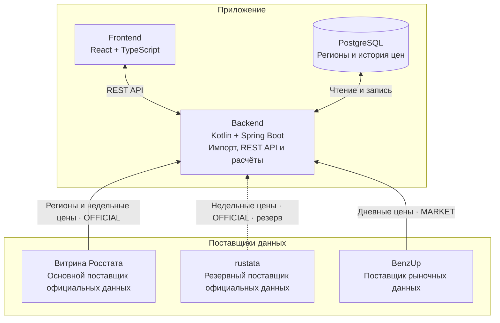

# Топливо для хозяйства

## Архитектура приложения



Backend загружает данные по расписанию и сохраняет их в PostgreSQL. rustata используется только при ошибке или недоступности Витрины Росстата. Frontend получает данные и результаты расчётов через API Backend.

## Автоматическое обновление данных

Загрузку запускает **Spring Scheduler по CRON**. По умолчанию используется московское время — **Europe/Moscow** (`IMPORTS_TIME_ZONE`).

| Что обновляется | Когда | CRON | Настройка в `.env` |
| --- | --- | --- | --- |
| Каталог регионов | Каждый понедельник в 03:00 | `0 0 3 * * MON` | `REGION_CATALOG_CRON` |
| Официальные цены — Росстат | Ежедневно в 00:00 | `0 0 0 * * *` | `ROSSTAT_CRON` |
| Рыночные цены — BenzUp | Ежедневно в 12:00 | `0 0 12 * * *` | `BENZUP_CRON` |

**rustata — резерв Росстата:** вызывается при ошибке или недоступности Витрины, собственного расписания нет.

**При старте приложения** проверяется каталог регионов, затем независимо запускается загрузка официальных и рыночных цен. Это поведение включено по умолчанию (`FETCH_ON_STARTUP=true`). `IMPORTS_ENABLED=false` отключает автоматический импорт целиком.

Формат CRON: `секунды минуты часы день_месяца месяц день_недели`.

## Запуск

Для сборки и запуска нужен Docker с Docker Compose. Все команды выполняются из корня проекта.

При первом запуске создайте файл настроек:

```sh
cp .env.example .env
```

Укажите пароль базы данных в `POSTGRES_PASSWORD` в файле `.env`.

Соберите образы и запустите сервисы:

```sh
docker compose up -d --build
```

Откройте [http://localhost:8081](http://localhost:8081). Если изменили `FRONTEND_PORT` в `.env`, используйте указанный порт. При первом запуске дождитесь загрузки данных.

## Остановка

```sh
docker compose down
```

Сохранённые данные остаются в Docker volume.
